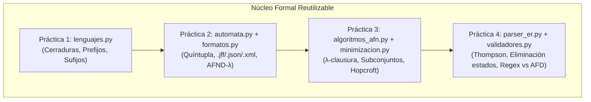

# ANÁLISIS GENERAL INTEGRAL — TEORÍA DE LA COMPUTACIÓN (2026–2027)

**Unidad de Aprendizaje:** Teoría de la Computación  
**Grupo:** 4CM4 / 4CV4 — Plan de Estudios: ISC 2020  
**Institución:** Instituto Politécnico Nacional — Escuela Superior de Cómputo (ESCOM)  
**Equipo de Desarrollo:**
* **A7LAS-1** (Antonio Navarro Domínguez — Boleta: 2025630725 — `tonyex1400@gmail.com`)
* **Kazuto834** (Mario García Castillo — Boleta: 2025630545 — `luilligar834@gmail.com`)

---

## 1. Inventario General de Prácticas y Estado Actual

| Identificador | Título Oficial | Estado General | Rama / Etiqueta Base | Entregable Principal |
| :--- | :--- | :--- | :--- | :--- |
| **Práctica 1** | *Operaciones Básicas sobre Lenguajes* | **Concluida y Fusionada** | Rama `master` (PR #1 cerrado) | Módulo `lenguajes.py`, app base Flet, docs 01–05, pruebas unitarias. |
| **Práctica 2** | *Autómatas Finitos No Deterministas (AFND) y Simulación de AFD con Interfaz Gráfica* | **En Desarrollo Activo** | Rama `Practica2` / Ramas modulares | Módulos `automata.py`, `formatos.py`, GUI Flet, suites pytest, clasificación L2/L3, investigación Rabin & Scott (1959). |
| **Práctica 3** | *Uso de JFLAP para Convertir AFD a ER y Extensión de Software (Simulación Directa, Eliminación $\lambda$, Subconjuntos y Minimización)* | **Planificada / Prerrequisitos Listos** | Etiqueta `practica3` | Algoritmos de conversión en Python puro, validación masiva por archivo, docs 01–03, pruebas automatizadas. |
| **Práctica 4** | *Uso de las Expresiones Regulares y Extensión de Software para Convertir Expresiones Regulares (Teorema de Kleene bidireccional y Validadores)* | **Planificada / Prerrequisitos Listos** | Etiqueta `practica4` | Parser de expresiones regulares, Kleene Parte I y II, validadores (Email, Teléfono, URL) comparados contra `re.fullmatch` ($\ge 500$ cadenas). |

---

## 2. Análisis Detallado por Práctica

### Práctica 1: Operaciones Básicas sobre Lenguajes
* **Objetivo:** Establecer el entorno de trabajo colaborativo con Git, GitHub y contenedores Docker; implementar operaciones algebraicas elementales sobre cadenas y alfabetos (prefijos, sufijos, subcadenas, cerradura de Kleene y cerradura positiva) con GUI interactiva en Flet y pruebas unitarias con Pytest.
* **Estado:** Totalmente finalizada en el repositorio. Archivos: `src/lenguajes.py`, `src/app.py`, `tests/test_lenguajes.py`, carpeta `docs/` con investigaciones 01 a 05 y bibliografía.
* **Regla de Integración:** **No modificar ni sobreescribir** este código. Todo trabajo futuro importa y reutiliza `lenguajes.py`.

---

### Práctica 2: Autómatas Finitos No Deterministas (AFND) y Simulación de AFD con Interfaz Gráfica
* **Objetivos:**
  1. Profundizar en los modelos no deterministas (AFND y AFND-$\lambda$) y sus conversiones mediante JFLAP y algoritmos propios.
  2. Implementar una arquitectura modular en Python desacoplada de la interfaz gráfica, capaz de representar formalmente la quíntupla $M = (Q, \Sigma, \delta, q_0, F)$.
  3. Soportar importación y exportación bidireccional en tres formatos estandarizados: `.jff` (JFLAP nativo en XML), `.json` estructurado y `.xml` canónico (Anexo 3).
  4. Proveer un simulador interactivo con traza paso a paso, visualización de caminos no deterministas y cálculo de $\lambda$-clausuras.
  5. Sustentar rigurosamente el no determinismo y su coste computacional ($2^n$) con base en literatura formal (artículo clásico de Rabin & Scott 1959 y artículos recientes indexados con DOI $\ge 2018$).
  6. Modelar un autómata finito formal de una aplicación del mundo real derivada de la literatura (ej. Pac-Man con 6 estados y 2 eventos nuevos, o protocolo TCP).
* **Ejercicios Requeridos:**
  * **Ejercicio 1:** Entorno y flujo de ramas. Configuración de CI con GitHub Actions (`.github/workflows/pruebas.yml`) con matriz de Python 3.11, 3.12 y 3.13. Al menos 4 ramas fusionadas mediante PRs descriptivos.
  * **Ejercicio 2:** AFND y AFND-$\lambda$ en JFLAP. Cobertura completa de Lista 2 (ejercicios 94 al 150) y Lista 3 (ejercicios 151 al 263). Clasificación en AFD, AFND estándar y AFND-$\lambda$. Diseño, simulación de al menos 5 cadenas válidas y 5 inválidas con bifurcaciones documentadas. Cálculo y justificación de $\lambda$-clausuras. Conversiones a AFD y tabla de 5 casos contrastando tamaño versus la cota $2^n$, explicando la familia de lenguajes donde la cota se alcanza exactamente ($L_n = \{w \in \{0,1\}^* \mid \text{el } n\text{-ésimo símbolo desde el final es } 1\}$).
  * **Ejercicio 3:** Simulador de autómatas con GUI en Python con Flet.
    * Definición interactiva de la quíntupla y tabla de transiciones.
    * Importador y exportador de archivos `.jff`, `.json` y `.xml`.
    * Simulación con traza paso a paso y decisión arquitectónica documentada para no determinismo.
    * Pruebas con pytest de inversión de formatos y simulación con $\lambda$-clausura.
  * **Ejercicio 4:** Investigación teórica y estado del arte.
    * 4.1: Ensayo académico (3–5 cuartillas) sobre no determinismo, $\lambda$-clausura, construcción de subconjuntos, cota $2^n$, teorema de Kleene, teorema de Myhill-Nerode, algoritmo de minimización de Hopcroft y equivalencia práctica.
    * 4.2: Ficha analítica de Rabin & Scott (1959) *Finite automata and their decision problems* (DOI: `10.1147/rd.32.0114`), diferencias de notación y mención del Premio Turing ACM 1976.
    * 4.3: Dos artículos académicos recientes ($\ge 2018$) con DOI verificable, incluyendo al menos una implementación de software medida.
  * **Ejercicio 5:** Del artículo al autómata. Formalización como quíntupla de un sistema real (Pac-Man ampliado a 6 estados), archivo `.jff`, simulación con 10 cadenas y ensayo de abstracción (media cuartilla). Propuesta adicional de trabajo (1 cuartilla).
* **Archivos a Desarrollar:**
  * `.github/workflows/pruebas.yml`
  * `src/automata.py` (Módulo del motor formal y algoritmos de simulación/$\lambda$-clausura)
  * `src/formatos.py` (Módulo de serialización I/O: `.jff`, `.json`, `.xml`)
  * `src/gui_simulador.py` (Módulo de interfaz gráfica desacoplada y controles interactivos)
  * `tests/test_automata.py` y `tests/test_formatos.py`
  * `docs/01-entorno.md`, `docs/02-jflap.md`, `docs/03-simulador.md`, `docs/04-investigacion.md`, `docs/05-del-articulo-al-automata.md`, `docs/propuesta.md`, `docs/bibliografia2.md`
  * `automatas/lista2-afd/`, `automatas/lista3-afnd/`, `automatas/lista3-afnd-lambda/`, `automatas/conversiones/`, `automatas/aplicacion/`

---

### Práctica 3: Uso de JFLAP para Convertir AFD a ER y Extensión de Software
* **Objetivos:** Extender el simulador interactivo implementando en Python puro los algoritmos formales de transformación de autómatas: cálculo de cerradura $\lambda$, eliminación de transiciones $\lambda$, construcción de subconjuntos (AFN $\to$ AFD) y minimización de AFD (Hopcroft / refinamiento de particiones y tabla de pares distinguibles), comprobando equivalencia contra JFLAP y mediante validación automatizada masiva.
* **Ejercicios Requeridos:**
  * **Ejercicio 1:** Conversión de 5 AFD seleccionados de Listas 2 y 3 a ER con JFLAP (método de eliminación de estados). Resolución analítica a mano de 2 autómatas por 3 métodos: Eliminación de estados, expresiones recurrentes $R_{ij}^{(k)}$ y Sistema de ecuaciones lineales con el Lema de Arden.
  * **Ejercicio 2:** Extensión de software en Python puro:
    * 2.1: Cálculo y visualización paso a paso de cerradura $\lambda$ y simulación directa de AFN-$\lambda$. Casos de prueba: Lista 3 (ejercicios 196 a 200).
    * 2.2: Eliminación de transiciones $\lambda$ produciendo AFN equivalente.
    * 2.3: Algoritmo de construcción de subconjuntos generando únicamente subconjuntos alcanzables y tabla de transiciones. Casos: Lista 3 (ejercicios 191–194, 260–263).
    * 2.4: Minimización de AFD eliminando estados inaccesibles y refinando particiones; prueba de equivalencia isomórfica entre dos AFD. Casos: Lista 3 (ejercicios 151–157).
    * 2.5: Carga masiva de cadenas desde archivo de texto plano y generación de reporte de resultados.
    * 2.6: Pruebas automatizadas con pytest verificando que AFN original, AFN sin $\lambda$, AFD subconjuntos y AFD mínimo aceptan exactamente el mismo lenguaje hasta longitud acotada $k$.
  * **Ejercicio 3:** Documentación teórica, pseudocódigos, correspondencia funcional, ejemplos de listas y análisis de complejidad asintótica en `docs/practica3/`.
* **Archivos a Desarrollar:**
  * `src/algoritmos_afn.py` (Cerradura $\lambda$, eliminación $\lambda$, construcción de subconjuntos)
  * `src/minimizacion.py` (Particionamiento, pares distinguibles, AFD mínimo, equivalencia de autómatas)
  * `src/validador_lotes.py` (Módulo de procesamiento por lotes desde archivo)
  * `tests/test_algoritmos_p3.py`
  * `docs/practica3/01-afd-a-er-jflap.md`, `docs/practica3/02-software.md`, `docs/practica3/03-algoritmos.md`
  * `automatas/practica3/afd-a-er/`, `automatas/practica3/casos-de-prueba/`
  * Etiqueta de Git `practica3`

---

### Práctica 4: Teorema de Kleene Bidireccional y Validadores de Expresiones Regulares
* **Objetivos:** Implementar en el software interactivo las dos direcciones completas del Teorema de Kleene: compilación sintáctica de expresiones regulares a AFN-$\lambda$ (construcción inductiva de Thompson), y conversión de AFD a expresiones regulares por eliminación de estados; implementar validadores de patrones reales (Email, Teléfono nacional, URL) y validar congruencia exhaustiva contra el motor estándar `re.fullmatch` con $\ge 500$ casos de prueba con pytest.
* **Ejercicios Requeridos:**
  * **Ejercicio 1:** Monografía de investigación (3–4 cuartillas): definición formal de lenguaje regular, jerarquía de Chomsky, teorema de Kleene, leyes algebraicas, lema de bombeo aplicado a referencias hacia atrás $(a^*)b\backslash 1$, y cinco aplicaciones prácticas en computación moderna.
  * **Ejercicio 2:** De Expresión Regular a Autómata:
    * Analizador léxico y sintáctico con precedencia de operadores ($* > \text{concatenación} > +$) y paréntesis con diagnóstico posicional de errores.
    * Construcción de Thompson (AFN-$\lambda$).
    * Canalización automática: AFN-$\lambda \to$ AFN sin $\lambda \to$ AFD subconjuntos $\to$ AFD mínimo.
    * Exportación a `.jff` y validación de cadenas contra la expresión. Casos: Lista 3 (241–253), Lista 4 (272, 273, 278).
  * **Ejercicio 3:** De Autómata a Expresión Regular:
    * Importación de AFD `.jff`, comprobación de determinismo, eliminación progresiva de estados con visualización del autómata generalizado y simplificación algebraica. Comparación con expresiones obtenidas en P3. Casos: Lista 3 (254–258), Lista 4 (276, 277).
  * **Ejercicio 4:** Validadores de aplicación:
    * Al menos 3 validadores formales: Dirección de correo electrónico, Teléfono celular/fijo nacional de México (10 dígitos según Plan Técnico de Numeración IFT), y URL web estándar (RFC 3986).
    * Traducción formal entre notación matemática y sintaxis `re` de Python.
    * Generación algorítmica de al menos 500 cadenas válidas e inválidas y suite de pruebas pytest que verifique $100\%$ de coincidencia entre el autómata simulado y `re.fullmatch`.
* **Archivos a Desarrollar:**
  * `src/parser_er.py` (Tokenizer, AST sintáctico y constructor de Thompson)
  * `src/er_a_automata.py` (Pipeline inductivo ER $\to$ AFN-$\lambda \to$ AFD Mínimo)
  * `src/automata_a_er.py` (Algoritmo de eliminación de estados en autómatas finitos generalizados)
  * `src/validadores.py` (Definición de modelos formales y generadores de casos de prueba)
  * `tests/test_kleene.py`, `tests/test_validadores.py`
  * `docs/practica4/01-investigacion-er.md`, `docs/practica4/02-er-a-automata.md`, `docs/practica4/03-automata-a-er.md`, `docs/practica4/04-validadores.md`
  * Etiqueta de Git `practica4`

---

## 3. Matriz de Seguimiento Global

| Práctica | Análisis | Arquitectura | Desarrollo | Pruebas | Documentación | Git / PRs | Estado General |
| :--- | :---: | :---: | :---: | :---: | :---: | :---: | :---: |
| **Práctica 1** | APROBADO | APROBADO | APROBADO | APROBADO | APROBADO | APROBADO (PR #1) | **CONCLUIDA** |
| **Práctica 2** | APROBADO | APROBADO | EN PROCESO | EN PROCESO | EN PROCESO | EN PROCESO | **EN CURSO** |
| **Práctica 3** | APROBADO | APROBADO | PENDIENTE | PENDIENTE | PENDIENTE | PENDIENTE | **PLANIFICADA** |
| **Práctica 4** | APROBADO | APROBADO | PENDIENTE | PENDIENTE | PENDIENTE | PENDIENTE | **PLANIFICADA** |

---

## 4. Dependencias e Interrelaciones Técnicas

### Reglas Críticas de Interoperabilidad:
1. **Inmutabilidad del Código Previo:** Las funciones existentes de `src/lenguajes.py` y `src/app.py` no deben romperse ni alterarse.
2. **Independencia del Núcleo Teórico:** Toda la lógica matemática (autómatas, formatos, conversiones, parsers) reside en módulos puros de Python sin dependencia de Flet ni de bibliotecas externas prohibidas.
3. **Determinismo y Rigor Académico:** Cada algoritmo implementado cuenta con demostración y sustento en las obras de referencia (Hopcroft et al., Sipser, Linz, Sudkamp).
