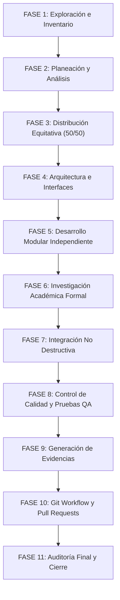

# PLAN DE DESARROLLO MODULAR — TEORÍA DE LA COMPUTACIÓN

## 1. Metodología de Desarrollo

El proyecto se rige por un esquema de trabajo estructurado en 11 fases estrictas, garantizando desarrollo modular, no regresión del código existente, verificación unitaria y de integración continua, y documentación académica rigurosa.



---

## 2. Definición Formal de Interfaces entre Módulos

Para permitir que ambos integrantes trabajen de manera completamente paralela e independiente sin dependencias bloqueantes, se establecen las firmas y estructuras de datos exactas:

### Módulo: `src/automata.py` (Responsable: A7LAS-1)
```python
class Transicion:
    origen: str
    simbolo: str       # '' denota transición lambda/épsilon
    destino: str

class Automata:
    estados: set[str]
    alfabeto: set[str]
    transiciones: list[Transicion]
    estado_inicial: str
    estados_aceptacion: set[str]
    
    def es_determinista(self) -> tuple[bool, str]:
        """Retorna (True, "") o (False, motivo detallado indicando estado y símbolo)."""
        ...
        
    def clausura_lambda(self, estados: set[str]) -> set[str]:
        """Calcula y retorna la clausura lambda del conjunto de estados."""
        ...
        
    def simular_cadena(self, cadena: str) -> tuple[bool, list[dict]]:
        """
        Ejecuta la simulación de la cadena.
        Retorna (aceptada, traza_paso_a_paso).
        traza incluye: paso, simbolo, estados_previos, transiciones_tomadas, estados_posteriores.
        """
        ...
        
    def obtener_tabla_transiciones(self) -> dict[str, dict[str, set[str]]]:
        """Retorna la matriz canónica delta[estado][simbolo] -> {destinos}."""
        ...
```

### Módulo: `src/formatos.py` (Responsable: Kazuto834)
```python
class FormatosAutomata:
    @staticmethod
    def cargar_jff(ruta_o_contenido: str) -> Automata:
        """Parsea XML de JFLAP 7.1 respetando <structure><automaton>..."""
        ...
        
    @staticmethod
    def guardar_jff(automata: Automata, ruta_salida: str) -> None:
        """Exporta en formato JFLAP con coordenadas visuales automáticas."""
        ...
        
    @staticmethod
    def cargar_json(ruta_o_contenido: str) -> Automata:
        """Carga según esquema Anexo 3 ({tipo, alfabeto, estados, inicial, aceptacion, transiciones})."""
        ...
        
    @staticmethod
    def guardar_json(automata: Automata, ruta_salida: str) -> None:
        """Exporta en formato JSON canónico serializado."""
        ...
        
    @staticmethod
    def cargar_xml(ruta_o_contenido: str) -> Automata:
        """Carga según esquema XML canónico Anexo 3."""
        ...
        
    @staticmethod
    def guardar_xml(automata: Automata, ruta_salida: str) -> None:
        """Exporta en formato XML canónico."""
        ...
```

### Módulo de Integración y Adaptador GUI: `src/gui_simulador.py` / `src/app.py`
* **Estrategia No Destructiva:**
  * El código actual de `src/app.py` (que resuelve las operaciones sobre cadenas de la Práctica 1) se preserva intacto.
  * Se construye el componente `SimuladorView` o pestaña modular dentro de `gui_simulador.py`, importando `Automata` y `FormatosAutomata`.
  * La aplicación principal integra las operaciones de cadenas y el simulador de autómatas mediante navegación por pestañas (`ft.Tabs`) sin alterar los callbacks originales de Práctica 1.

---

## 3. Plan de Ejecución por Práctica

### Práctica 2: En Ejecución
1. Configurar integración continua en `.github/workflows/pruebas.yml`.
2. Implementar `src/automata.py` y `tests/test_automata.py` (A7LAS-1).
3. Implementar `src/formatos.py` y `tests/test_formatos.py` (Kazuto834).
4. Implementar `src/gui_simulador.py` e integración en `src/app.py` (Kazuto834).
5. Documentar investigación 4.1 y artículo clásico 4.2 / artículos 4.3 en `docs/04-investigacion.md`.
6. Diseñar modelo de Pac-Man (6 estados) en `docs/05-del-articulo-al-automata.md` y `automatas/aplicacion/pacman_extended.jff`.
7. Completar clasificación de autómatas de Listas 2 y 3 en `docs/02-jflap.md` y generar los archivos `.jff`, `.json` y `.xml`.
8. Ejecutar suite de pruebas completa en local con pytest y generar reporte QA.

### Práctica 3: En Espera de Finalización de P2
1. Implementar `src/minimizacion.py` (Hopcroft / refinamiento) (A7LAS-1).
2. Implementar `src/algoritmos_afn.py` (Subconjuntos y eliminación $\lambda$) (Kazuto834).
3. Implementar `src/validador_lotes.py` y tests automatizados con pytest de equivalencia de lenguajes.
4. Redactar resoluciones analíticas de AFD a ER en `docs/practica3/01-afd-a-er-jflap.md` y documentación de algoritmos en `docs/practica3/03-algoritmos.md`.

### Práctica 4: En Espera de Finalización de P3
1. Implementar `src/parser_er.py` y Thompson inductivo (A7LAS-1).
2. Implementar `src/automata_a_er.py` (Eliminación de estados) (Kazuto834).
3. Implementar `src/validadores.py` y suite de 500 pruebas contra `re.fullmatch` (Kazuto834).
4. Documentar monografía de expresiones regulares y bombeo en `docs/practica4/01-investigacion-er.md`.

