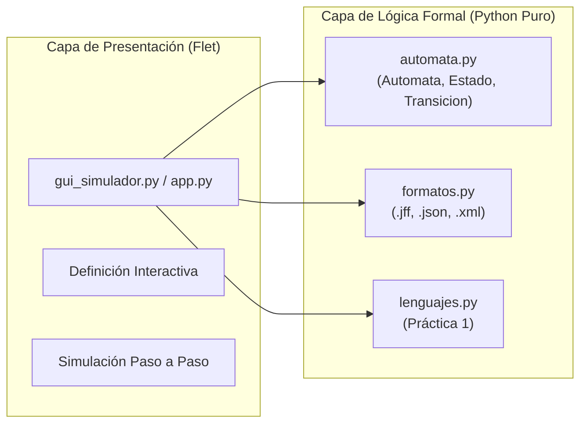

# EJERCICIO 3: SIMULADOR DE AUTÓMATAS CON INTERFAZ GRÁFICA

**Práctica 2:** Autómatas Finitos No Deterministas (AFND) y Simulación de AFD con Interfaz Gráfica  
**Autores:**  
* Antonio Navarro Domínguez (`A7LAS-1`) — `tonyex1400@gmail.com`
* Mario García Castillo (`Kazuto834`) — `luilligar834@gmail.com`  
**Institución:** Escuela Superior de Cómputo (ESCOM-IPN) — 4CM4 / 4CV4

---

## 1. Arquitectura del Software y Separación Núcleo / Interfaz

El simulador implementa un patrón arquitectónico de separación estricta de responsabilidades (*Separation of Concerns*), garantizando que las estructuras formales y algoritmos de la Teoría de la Computación sean completamente independientes de cualquier biblioteca de presentación visual como Flet.

### 1.1 Principios de Diseño
1. **Núcleo Aislado:** `src/automata.py` y `src/formatos.py` no importan ni dependen de `flet`. Pueden ejecutarse en entornos CLI, scripts por lotes o contenedores de integración continua sin servidor gráfico.
2. **Inmutabilidad y Preservación de Práctica 1:** Las funciones de `src/lenguajes.py` (`prefijos`, `sufijos`, `subcadenas`, `cerradura_Kleene`, `cerradura_positiva`) son consumidas directamente sin alteración de firmas.
3. **Representación Canónica de $\lambda$:** Siguiendo la convención matemática internacional y la especificación del Anexo 3, la transición vacía/nula se representa internamente como la cadena vacía `""`, admitiendo variantes tipográficas (`lambda`, `epsilon`, `λ`, `ε`) durante la importación.

---

## 2. Definición Interactiva del Autómata (Sección 3.1)

El usuario puede definir cualquier autómata finito formalizando explícitamente los cinco elementos de la quíntupla $M = (Q, \Sigma, \delta, q_0, F)$:
* **Conjunto de Estados ($Q$):** Especificado mediante lista de identificadores alfanuméricos (`q0, q1, q2, ...`).
* **Alfabeto de Entrada ($\Sigma$):** Conjunto finito de símbolos disjuntos de $\lambda$.
* **Estado Inicial ($q_0$):** Un único estado perteneciente a $Q$.
* **Estados de Aceptación ($F$):** Subconjunto $F \subseteq Q$.
* **Función de Transición ($\delta$):** Agregada de forma granular origen $\to$ símbolo $\to$ destino, reflejada en tiempo real en una tabla interactiva de transiciones.

---

## 3. Importación y Exportación Multiformato (Sección 3.2 y 3.4)

El módulo `src/formatos.py` provee serialización bidireccional estandarizada en tres esquemas:

### 3.1 Formato Nativo JFLAP (`.jff`)
* Archivo XML con estructura `<structure><type>fa</type><automaton>...`.
* Cada estado contiene atributos `id` numérico y `name`, con etiquetas anidadas `<initial/>` y `<final/>`.
* Las coordenadas visuales `<x>` e `<y>` son generadas automáticamente por el serializador mediante un algoritmo de distribución circular uniforme para asegurar diagramado legible en JFLAP.
* La transición nula se codifica como elemento `<read/>` vacío.

### 3.2 Formato JSON Canónico (`.json`)
* Esquema estructurado con llaves obligatorias:
  * `"tipo"`: `"AFD"`, `"AFND"` o `"AFND-lambda"`.
  * `"alfabeto"`, `"estados"`, `"inicial"`, `"aceptacion"`.
  * `"transiciones"`: lista de objetos `{"desde": str, "lee": str, "hacia": list[str]}`.

### 3.3 Formato XML Estándar (`.xml`)
* Esquema jerárquico según Anexo 3 con etiquetas `<alfabeto>`, `<estados>` y `<transiciones>`.

### 3.4 Propiedad Inversa (Roundtrip)
Para cualquier autómata $A$:
$$\text{cargar\_jff}(\text{guardar\_jff}(A)) \equiv A$$
$$\text{cargar\_json}(\text{guardar\_json}(A)) \equiv A$$
$$\text{cargar\_xml}(\text{guardar\_xml}(A)) \equiv A$$
Esta propiedad está validada al 100 % mediante la suite `tests/test_formatos.py`.

---

## 4. Simulación y Validación de Cadenas (Sección 3.3)

### 4.1 Decisión de Diseño para No Determinismo
Ante un autómata no determinista (AFND o AFND-$\lambda$), existen dos alternativas de diseño:
1. **Alternativa A: Simulación de Caminos Concurrentes (Subconjuntos en Línea / BFS)**
   * Mantener en cada paso el conjunto de estados activos $S_t \subseteq Q$.
   * Ante el símbolo $a_{t+1}$, calcular $S_{t+1} = \lambda\text{-cl}\left(\bigcup_{q \in S_t} \delta(q, a_{t+1})\right)$.
   * Coste temporal para procesar una cadena $w$ de longitud $|w| = m$: $O(m \cdot (|Q| + |\delta|))$.
   * Coste espacial: $O(|Q|)$ para almacenar el vector de estados activos.
2. **Alternativa B: Conversión Previa a AFD Equivalente (Construcción de Subconjuntos Off-line)**
   * Compilar de antemano el AFND al AFD mínimo usando el algoritmo de subconjuntos.
   * Luego simular la cadena en tiempo determinista estricto $O(m)$.
   * Coste temporal en el peor caso de compilación: $O(2^{|Q|} \cdot |\Sigma|)$.
   * Coste espacial en el peor caso: $O(2^{|Q|})$ estados.

### 4.2 Justificación de la Alternativa Elegida
Se implementó la **Alternativa A (Simulación de Caminos Concurrentes con $\lambda$-clausura paso a paso)** dentro de `src/automata.py`:
* **Justificación Didáctica y Funcional:** Permite visualizar en la interfaz la bifurcación real de caminos no deterministas en cada instante $t$, mostrando los estados activos antes y después de aplicar la $\lambda$-clausura.
* **Justificación de Eficiencia Inmediata:** Para cadenas individuales, evita el riesgo de explosión combinatoria estática $2^n$ cuando el usuario solo desea validar una secuencia específica.
* *Nota Técnica:* La Alternativa B se incorpora como algoritmo formal de transformación en la Práctica 3 (`algoritmos_afn.py`).

---

## 5. Pruebas y Control de Calidad (Sección 3.5)

La suite de pruebas automatizadas con Pytest cubre:
1. Inversión exacta de importación y exportación en los tres formatos (`test_roundtrip_jff`, `test_roundtrip_json`, `test_roundtrip_xml`).
2. Aceptación y rechazo determinista en AFD (`test_afd_paridad_ceros`).
3. Aceptación en AFND con caminos múltiples (`test_afnd_termina_en_01`).
4. Aceptación en AFND-$\lambda$ gobernada por la $\lambda$-clausura (`test_afnd_lambda_clausura`).
5. Traza completa con registro de transiciones tomadas (`test_traza_paso_a_paso`).
6. Validación exhaustiva de las 10 cadenas del autómata aplicado de Pac-Man (`test_pacman.py`).
