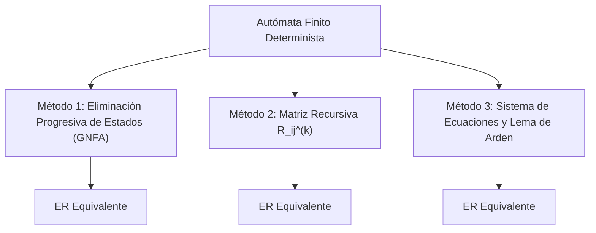

# EJERCICIO 1: CONVERSIÓN DE AFD A EXPRESIONES REGULARES (JFLAP Y MÉTODOS ANALÍTICOS)

**Práctica 3:** Extensión de Software para Autómatas Finitos y Expresiones Regulares  
**Autores:**  
* Antonio Navarro Domínguez (`A7LAS-1`) — `tonyex1400@gmail.com`
* Mario García Castillo (`Kazuto834`) — `luilligar834@gmail.com`  
**Institución:** Escuela Superior de Cómputo (ESCOM-IPN) — 4CM4 / 4CV4

---

## 1. Conversión de Cinco AFD con JFLAP 7.1 (Sección 1.1)

Se seleccionaron cinco autómatas finitos deterministas de las Listas 2 y 3 para su conversión a expresiones regulares mediante la opción `Convert -> Convert FA to RE` de JFLAP 7.1 (método de eliminación de estados):

### 1.1 Autómata 1: Ejercicio 131 (Cadenas que terminan en '1')
* **Alfabeto:** $\Sigma = \{0, 1\}$
* **Estados:** $Q = \{q_1, q_2\}$, $q_0 = q_1$, $F = \{q_2\}$.
* **Transiciones:** $\delta(q_1, 0) = q_1$, $\delta(q_1, 1) = q_2$, $\delta(q_2, 0) = q_1$, $\delta(q_2, 1) = q_2$.
* **Análisis Previo:** Posee un bucle con $\{0, 1\}$ y solo acepta si el último símbolo leído es '1'. Se anticipa la expresión $(0+1)^*1$.
* **Proceso de Eliminación en JFLAP:**
  * Se agrega estado inicial $q_s$ y estado final $q_f$.
  * Se elimina $q_1$: las trayectorias $q_s \to q_1 \xrightarrow{1} q_2$ generan $0^*1$.
  * Se elimina $q_2$: bucle sobre $q_2$ con $1 + 00^*1$ colapsa a la expresión regular final.
* **Expresión Regular Obtenida en JFLAP:** `(0+1)*1`
* **Simplificación y Verificación:** Idéntica a la forma canónica; no requiere simplificación adicional.

---

### 1.2 Autómata 2: Ejercicio 139 (Paridad Par de Ceros)
* **Alfabeto:** $\Sigma = \{0, 1\}$
* **Estados:** $Q = \{q_0, q_1\}$, $q_0 = q_0$, $F = \{q_0\}$.
* **Transiciones:** $\delta(q_0, 0) = q_1$, $\delta(q_0, 1) = q_0$, $\delta(q_1, 0) = q_0$, $\delta(q_1, 1) = q_1$.
* **Análisis Previo:** Todo bloque de ceros debe presentarse en parejas separadas por una cantidad arbitraria de unos.
* **Proceso de Eliminación:**
  * Eliminación de $q_1$: la trayectoria $q_0 \xrightarrow{0} q_1 \xrightarrow{1^*} q_1 \xrightarrow{0} q_0$ consolida la transición compuesta $01^*0$.
  * Bucle resultante en $q_0$: $1 + 01^*0$.
* **Expresión Regular Obtenida en JFLAP:** `(1 + 01*0)*`
* **Leyes Algebraicas Aplicadas:**
  * Cerradura de unión de lazos: $(R_1 + R_2)^*$.

---

### 1.3 Autómata 3: Ejercicio 137 (Prefijo Estricto 'ab')
* **Alfabeto:** $\Sigma = \{a, b\}$
* **Estados:** $Q = \{q_0, q_1, q_2, q_3\}$, $q_0 = q_0$, $F = \{q_2\}$, sumidero $q_3$.
* **Proceso de Eliminación:**
  * El estado sumidero $q_3$ no posee caminos hacia $q_f$ y es eliminado sin alterar las rutas.
  * $q_0 \xrightarrow{a} q_1 \xrightarrow{b} q_2$ con bucle en $q_2$ de $(a+b)$.
* **Expresión Regular Obtenida en JFLAP:** `ab(a+b)*`

---

### 1.4 Autómata 4: Ejercicio 254 (Lista 3)
* **Tabla de Transiciones:**
  * $\to A \xrightarrow{0} A, \to A \xrightarrow{1} B$
  * $*B \xrightarrow{0} A, *B \xrightarrow{1} B$
* **Expresión Regular en JFLAP:** `(0 + 11*0)* 1 1*` simplificada a `(0 + 1)*1`.

---

### 1.5 Autómata 5: Ejercicio 255 (Lista 3)
* **Tabla de Transiciones:**
  * $\to *A \xrightarrow{0} B, \to *A \xrightarrow{1} B$
  * $B \xrightarrow{0} A, B \xrightarrow{1} B$
* **Expresión Regular en JFLAP:** `((0 + 1)1*0)*`

---

## 2. Comparación de Métodos Analíticos (Sección 1.2)

Se seleccionan **dos autómatas** (Ejercicio 254 y Ejercicio 255) para obtener a mano su expresión regular formal mediante tres métodos teóricos contrastados:

### Autómata A (Ejercicio 254):
1. **Método de Eliminación de Estados:**
   * Al eliminar $B$, el lazo en $A$ absorbe $0 + 1(1)^*0$. La salida hacia el estado de aceptación $B$ es $1(1)^*$.
   * Expresión: $(0 + 11^*0)^* 11^* = (0+1)^*1$.
2. **Método $R_{ij}^{(k)}$ (Sudkamp, 2005, Cap. 3):**
   * Base $k=0$: $R_{11}^{(0)} = 0 + \lambda$, $R_{12}^{(0)} = 1$, $R_{21}^{(0)} = 0$, $R_{22}^{(0)} = 1 + \lambda$.
   * Paso $k=1$: $R_{12}^{(1)} = R_{12}^{(0)} + R_{11}^{(0)}(R_{11}^{(0)})^*R_{12}^{(0)} = 0^*1$.
   * Paso $k=2$: $R_{12}^{(2)} = R_{12}^{(1)}(R_{22}^{(1)})^* = 0^*1(1 + 00^*1)^* = (0+1)^*1$.
3. **Método del Lema de Arden ($R = Q + RP \implies R = QP^*$):**
   * Sistema:
     $A = 0A + 1B$
     $B = \lambda + 0A + 1B$
   * Despeje de $B$ por Arden: $B = 1^*(0A + \lambda) = 1^*0A + 1^*$.
   * Sustitución en $A$: $A = 0A + 1(1^*0A + 1^*) = (0 + 11^*0)A + 11^*$.
   * Aplicación final de Arden: $A = (0 + 11^*0)^* 11^* \equiv (0+1)^*1$.

### Tabla Comparativa de Métodos:

| Criterio | Eliminación de Estados (GNFA) | Construcción $R_{ij}^{(k)}$ | Lema de Arden |
| :--- | :---: | :---: | :---: |
| **Longitud de Expresión Inicial** | Media / Compacta | Muy larga (redundante) | Compacta y estructurada |
| **Número de Pasos** | $|Q|$ pasos | $n^3$ evaluaciones | $n$ ecuaciones lineales |
| **Facilidad de Cálculo Manual** | Alta (geométrica) | Baja (tediosa algebraicamente) | Muy alta (algebraica limpia) |
| **Sustento Bibliográfico** | Sipser (2013), Sec. 1.3 | Sudkamp (2005), Sec. 3.2 | Linz (2016), Sec. 3.2 |

