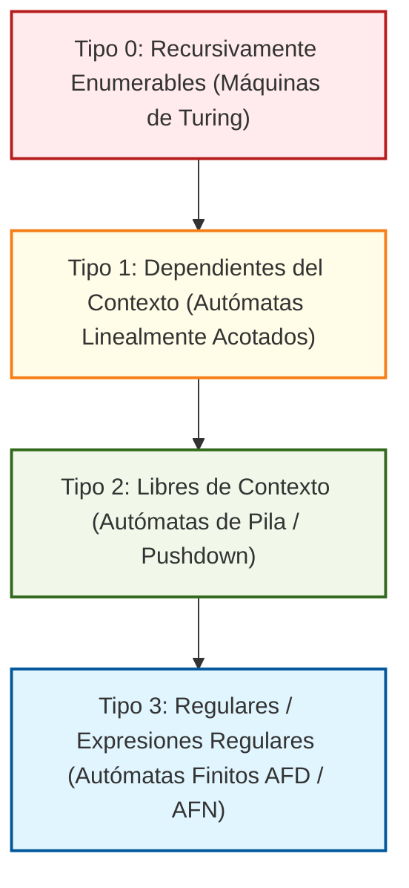

# Práctica 4: Expresiones Regulares, Autómatas Finitos y Aplicaciones Avanzadas en Teoría de la Computación

> **Institución:** Escuela Superior de Cómputo (ESCOM) — Instituto Politécnico Nacional (IPN)  
> **Unidad de Aprendizaje:** Teoría de la Computación  
> **Autor:** Redactor Académico Especializado  

---

## 1. Introducción y Definición Formal de Expresiones Regulares

En la Teoría de la Computación, el estudio de los lenguajes formales y los modelos de cómputo abstractos constituye el pilar fundamental sobre el cual se edifican los compiladores, los analizadores léxicos, los procesadores de textos y los sistemas de validación de sintaxis. Las expresiones regulares (ER) representan un formalismo declarativo de notable elegancia matemática para denotar conjuntos de cadenas sobre un alfabeto finito.

### 1.1 Alfabeto y Lenguaje Formal

*   **Alfabeto ($\Sigma$):** Un conjunto finito y no vacío de símbolos abstractos. Por ejemplo, $\Sigma = \{0, 1\}$ o $\Sigma = \{a, b, c\}$.
*   **Palabra o Cadena ($w$):** Una secuencia finita de símbolos concatenados tomados de un alfabeto $\Sigma$. La longitud de una cadena $w$, denotada por $|w|$, es el número de símbolos que la componen. La palabra vacía, denotada por $\lambda$ (o $\epsilon$), es la única cadena de longitud cero ($|\lambda| = 0$).
*   **Lenguaje Formal ($L$):** Un subconjunto de $\Sigma^*$, donde $\Sigma^*$ denota el conjunto de todas las cadenas posibles (incluyendo $\lambda$) construibles con los símbolos de $\Sigma$.

### 1.2 Definición Inductiva de Expresión Regular y su Lenguaje Denotado

Sea $\Sigma$ un alfabeto dado. Las expresiones regulares sobre $\Sigma$ y los lenguajes que cada una denota se definen inductivamente de la siguiente manera:

1.  **Casos Base:**
    *   $\emptyset$ es una expresión regular que denota el lenguaje vacío: $L(\emptyset) = \emptyset$.
    *   $\lambda$ es una expresión regular que denota el lenguaje conteniendo únicamente la palabra vacía: $L(\lambda) = \{\lambda\}$.
    *   Para cada símbolo $a \in \Sigma$, $a$ es una expresión regular que denota el lenguaje $\{a\}$: $L(a) = \{a\}$.

2.  **Pasos Inductivos:**
    Sean $r$ y $s$ expresiones regulares que denotan los lenguajes $L(r)$ y $L(s)$ respectivamente.
    *   **Unión (Suma o Alternativa):** $(r + s)$ o $(r \cup s)$ es una expresión regular que denota la unión de los dos lenguajes: 
        $$L(r + s) = L(r) \cup L(s)$$
    *   **Concatenación (Producto):** $(r \cdot s)$ (frecuentemente escrita como $rs$) es una expresión regular que denota la concatenación de las cadenas de ambos lenguajes:
        $$L(rs) = \{xy \mid x \in L(r) \text{ y } y \in L(s)\}$$
    *   **Cerradura de Kleene (Estrella):** $(r^*)$ es una expresión regular que denota la cerradura de Kleene del lenguaje $L(r)$, definida como la unión finita de potencias del lenguaje:
        $$L(r^*) = \bigcup_{k=0}^{\infty} L(r)^k = \{\lambda\} \cup L(r) \cup L(r)L(r) \cup L(r)L(r)L(r) \cup \dots$$

---

## 2. Ubicación en la Jerarquía de Chomsky y Poder Expansivo

Noam Chomsky estableció una clasificación jerárquica de las gramáticas formales y los lenguajes asociados en cuatro niveles (Tipos 3 al 0), cada uno caracterizado por restricciones sintácticas más estrictas y modelos computacionales reconocedores correspondientes.

### 2.1 Tabla Comparativa de Clases de Lenguajes Formales

| Clase de Lenguaje | Gramática Asociada | Modelo de Reconocimiento | Capacidad de Memoria | Restricciones de Producción | Ejemplos Clave |
| :--- | :--- | :--- | :--- | :--- | :--- |
| **Tipo 3: Regular** | Regular (Derecha/Izquierda) | Autómata Finito Determinista / No Determinista (AFD / AFN) | Finita ($O(1)$) | $A \rightarrow aB$, $A \rightarrow a$ | Identificadores, números enteros, correos electrónicos simples. |
| **Tipo 2: Libre de Contexto** | Independiente del Contexto | Autómata de Pila (*Pushdown Automaton*, PDA) | Externa con Pila LIFO ilimitada ($O(n)$) | $A \rightarrow \gamma$ (donde $A \in V$, $\gamma \in (V \cup \Sigma)^*$) | Balanceo de paréntesis, bloques de código anidados, $a^n b^n$. |
| **Tipo 1: Dependiente del Contexto** | Sensible al Contexto | Autómata Linealmente Acotado (LBA) | Lineal acotada a la longitud de la entrada ($O(n)$) | $\alpha A \beta \rightarrow \alpha \gamma \beta$ con $|\gamma| \ge |\alpha A \beta|$ | $a^n b^n c^n$, concordancia de género y número. |
| **Tipo 0: Recursivamente Enumerable** | Irrestricta / Sin restricciones | Máquina de Turing (MT) | Infinita y arbitraria (Cinta ilimitada) | $\alpha \rightarrow \beta$ sin restricciones de longitud | El Problema de la Parada (*Halting Problem*), cálculo computable general. |

---

## 3. Teorema de Kleene (Equivalencia entre ER y Autómatas Finitos)

El Teorema de Kleene establece la equivalencia fundamental de la teoría de autómatas: una clase de lenguajes es descrita por expresiones regulares si y sólo si es aceptada por un autómata finito.

### 3.1 Dirección 1: De Expresión Regular a Autómata (Construcción de Thompson)

Cualquier lenguaje denotado por una expresión regular $r$ puede ser aceptado por un Autómata Finito No Determinista con transiciones $\lambda$ ($\text{AFN-}\lambda$). La construcción recursiva de Thompson opera componiendo autómatas elementales para los casos base y aplicando operadores inductivos:

*   **Caso $\emptyset$:** Un autómata con un estado inicial $s_0$ y un estado de aceptación $f$, sin transiciones.
*   **Caso $\lambda$:** Un autómata con $s_0$ y $f$ unidos por una transición $\lambda$.
*   **Caso $a \in \Sigma$:** Un autómata con $s_0$ y $f$ unidos por una transición rotulada con $a$.
*   **Unión $r + s$:** Se crea un nuevo estado inicial que bifurca mediante $\lambda$-transiciones a los autómatas de $r$ y $s$, cuyos estados finales convergen mediante $\lambda$-transiciones a un nuevo estado de aceptación final.
*   **Concatenación $rs$:** Se fusiona el estado final del autómata $r$ con el estado inicial del autómata $s$.
*   **Cerradura de Kleene $r^*$:** Se introduce un nuevo estado inicial y un nuevo estado final, conectados mediante $\lambda$-transiciones que permiten rodear el autómata $r$ (cero repeticiones) o retornar desde el final al inicio de $r$ (repeticiones múltiples).

### 3.2 Dirección 2: De Autómata Finito a Expresión Regular (Método de Eliminación de Estados / GNFA)

Dado un Autómata Finito Determinista (AFD) con un conjunto de estados $Q$, se puede transformar en un Autómata Finito No Determinista Generalizado (GNFA) cuyas transiciones están etiquetadas por expresiones regulares. Mediante la eliminación sistemática de estados intermedios hasta conservar únicamente el estado inicial y un único estado de aceptación, la etiqueta de la transición restante constituye la expresión regular equivalente.

Matemáticamente, para cualquier terna de estados $(i, j, k)$, la actualización de la expresión regular de la transición $R_{ij}^{(k)}$ a partir de la etapa anterior se define como:
$$R_{ij}^{(k)} = R_{ij}^{(k-1)} \cup R_{ik}^{(k-1)} (R_{kk}^{(k-1)})^* R_{kj}^{(k-1)}$$

### 3.3 Referencias Bibliográficas Oficiales
*   **Hopcroft, J. E., Motwani, R., & Ullman, J. D. (2007).** *Introduction to Automata Theory, Languages, and Computation* (3rd ed.). Addison-Wesley. Capítulo 3.
*   **Sipser, M. (2013).** *Introduction to the Theory of Computation* (3rd ed.). Cengage Learning. Capítulo 1.

---

## 4. Leyes Algebraicas de las Expresiones Regulares

Las expresiones regulares forman un Álgebra de Kleene. Sean $r, s, t$ expresiones regulares arbitrarias sobre un alfabeto $\Sigma$, y $\emptyset$ el conjunto vacío, $\lambda$ la palabra vacía. Las leyes fundamentales que rigen la manipulación y simplificación algebraica son:

1.  **Leyes de Identidad:**
    *   $r + \emptyset = \emptyset + r = r$ (Elemento neutro para la unión)
    *   $r\lambda = \lambda r = r$ (Elemento neutro para la concatenación)
2.  **Elemento Absorbente / Aniquilador:**
    *   $r\emptyset = \emptyset r = \emptyset$
3.  **Conmutatividad de la Unión:**
    *   $r + s = s + r$
4.  **Asociatividad:**
    *   $(r + s) + t = r + (s + t)$
    *   $(rs)t = r(st)$
5.  **Distributividad:**
    *   $r(s + t) = rs + rt$ (Distributividad por la izquierda)
    *   $(s + t)r = sr + tr$ (Distributividad por la derecha)
6.  **Idempotencia de la Unión:**
    *   $r + r = r$
7.  **Leyes de la Cerradura de Kleene (*):**
    *   $\emptyset^* = \lambda$
    *   $\lambda^* = \lambda$
    *   $r^* = \lambda + r r^* = (\lambda + r)^*$
    *   $(r^*)^* = r^*$
    *   $r r^* = r^* r$
    *   $(r + s)^* = (r^* s^*)^* = (r^* + s^*)^*$

Estas identidades algébricas permiten optimizar y simplificar expresiones complejas antes de su implementación en compiladores o analizadores léxicos.

---

## 5. Expresiones Regulares Teóricas vs. Prácticas (Regex en Lenguajes de Programación)

### 5.1 Diferencias Fundamentales de Poder Expansivo

En la práctica computacional moderna, las herramientas de procesamiento de texto (PCRE en C/C++, `re` en Python, JavaScript `RegExp`, Perl) emplean motores basados en retroceso (*backtracking*) que extienden notablemente el formalismo de las expresiones regulares teóricas.

*   **Expresiones Regulares Teóricas (Tipo 3):** Describen estrictamente lenguajes regulares. Son reconocidas por autómatas finitos con complejidad temporal lineal $O(n)$ y consumo de memoria espacial estricta $O(1)$, independiente de la longitud de la entrada. Carecen de memoria auxiliar para recordar tramos coincidentes previos.
*   **Expresiones Regulares Prácticas (Regex de Programación):** Incorporan características avanzadas como **retro-referencias** (*backreferences*, ej. `\1`), **aserciones de mirada hacia adelante (*lookahead*, `(?=...)`)** y **hacia atrás (*lookbehind*, `(?<=...)`)**. Estas características permiten reconocer lenguajes libres de contexto e incluso sensibles al contexto, elevando la complejidad computacional en el peor de los casos a tiempos exponenciales $O(2^n)$ debido al *backtracking* exhaustivo.

### 5.2 Análisis Profundo del Patrón con Backreference `(a*)b\1`

Consideremos el lenguaje denotado por la expresión práctica con retro-referencia:
$$L = \{a^n b a^n \mid n \ge 0\}$$

El patrón `(a*)b\1` desglosa su funcionamiento de la siguiente manera:
1.  `(a*)` captura una secuencia de cero o más símbolos `a` en un grupo de captura número 1.
2.  `b` empareja obligatoriamente el carácter delimitador central `b`.
3.  `\1` fuerza que el segmento final de la cadena sea idénticamente la secuencia de caracteres capturada en el grupo 1 (es decir, exactamente $n$ símbolos `a`).

### 5.3 Demostración Rigurosa con el Lema de Bombeo para Lenguajes Regulares

Para demostrar que el lenguaje $L = \{a^n b a^n \mid n \ge 0\}$ **no** es un lenguaje regular, aplicamos el Lema de Bombeo (*Pumping Lemma*) mediante una demostración por contradicción.

**Teorema (Lema de Bombeo):** Si $L$ es un lenguaje regular, existe una constante de bombeo $p > 0$ tal que cualquier cadena $s \in L$ con $|s| \ge p$ puede descomponerse en tres segmentos $s = xyz$ que satisfacen las siguientes condiciones:
1.  $|xy| \le p$
2.  $|y| \ge 1$
3.  Para todo entero $i \ge 0$, la cadena $xy^i z \in L$.

**Demostración:**
1.  Supongamos, por hipótesis de contradicción, que $L = \{a^n b a^n \mid n \ge 0\}$ es un lenguaje regular.
2.  Sea $p$ la constante de bombeo garantizada por el Lema de Bombeo.
3.  Elijamos la cadena $s = a^p b a^p$. Es evidente que $s \in L$ y que su longitud es $|s| = 2p + 1 \ge p$.
4.  De acuerdo con el lema, debemos poder descomponer $s = xyz$ tal que $|xy| \le p$ y $|y| \ge 1$.
5.  Dado que la condición $|xy| \le p$ restringe los primeros $p$ caracteres de $s$, y los primeros $p$ caracteres de $s$ consisten únicamente en símbolos $a$ (el bloque $a^p$), los segmentos $x$ e $y$ están compuestos exclusivamente por letras $a$.
6.  Sea $|y| = k$, donde $1 \le k \le p$. Esto implica que $y = a^k$.
7.  Consideremos el caso al bombear con $i = 2$. Según el lema, la cadena $xy^2 z$ debe pertenecer a $L$.
8.  La cadena resultante es:
    $$xy^2 z = a^{p+k} b a^p$$
9.  Para que $xy^2 z \in L$, el número de símbolos $a$ antes de la $b$ y después de la $b$ debe ser exactamente idéntico. Sin embargo, tenemos $p+k$ símbolos $a$ a la izquierda de $b$ y $p$ símbolos $a$ a la derecha. Como $k \ge 1$, se cumple que $p+k \neq p$.
10. Por lo tanto, $xy^2 z \notin L$, lo cual contradice directamente el Lema de Bombeo.
11. Concluimos que la suposición inicial es falsa: **el lenguaje $L$ no es regular**. $\blacksquare$

---

## 6. Cinco Aplicaciones Reales en la Computación Actual

### 6.1 Análisis Léxico en Compiladores e Intérpretes (Flex / Lex)
En la fase de análisis léxico, herramientas como Flex convierten especificaciones de tokens basadas en expresiones regulares en autómatas finitos optimizados.
*   **Expresión Regular Concreta (Identificadores de C/C++):** `[a-zA-Z_][a-zA-Z0-9_]*`
*   **Explicación:** Reconoce una letra o guion bajo inicial seguido de cualquier combinación de letras, dígitos o guiones bajos, permitiendo extraer nombres de variables válidos en código fuente.

### 6.2 Búsqueda de Patrones y Motores de Línea de Comandos (`grep`, `ripgrep`)
Utilizado en auditorías de código y minería de texto para localizar ocurrencias complejas en millones de líneas de código fuente.
*   **Expresión Regular Concreta (Direcciones IPv4 válidas simplificadas):** `\b(?:(?:25[0-5]|2[0-4][0-9]|[01]?[0-9][0-9]?)\.){3}(?:25[0-5]|2[0-4][0-9]|[01]?[0-9][0-9]?)\b`
*   **Explicación:** Valida octetos numéricos de 0 a 255 separados por puntos exactos delimitados por fronteras de palabras (`\b`).

### 6.3 Validación de Datos en Formularios Web y APIs
Garantiza la integridad estructural de los datos de entrada antes de su persistencia en bases de datos relacionales o NoSQL.
*   **Expresión Regular Concreta (Formato de Fecha ISO 8601 `AAAA-MM-DD`):** `^\d{4}-(?:0[1-9]|1[0-2])-(?:0[1-9]|[12]\d|3[01])$`
*   **Explicación:** Asegura un año de 4 dígitos, un mes válido del 01 al 12 y un día válido del 01 al 31.

### 6.4 Filtrado y Auditoría de Logs (SIEM / Syslog / Elasticsearch)
Permite extraer métricas de seguridad, direcciones IP maliciosas o códigos de estado HTTP a partir de flujos masivos de registros de servidores web (Apache/Nginx).
*   **Expresión Regular Concreta (Código de Estado HTTP 5xx en Log de Nginx):** `\"\s[5]\d{2}\s`
*   **Explicación:** Detecta errores de servidor (500, 502, 504, etc.) incrustados en las cadenas de peticiones de bitácora.

### 6.5 Automatización y Scripting en Sistemas Operativos (`sed`, `awk`, `zsh`)
Herramientas fundamentales para refactorización masiva de archivos de configuración y procesamiento de flujos de texto en entornos UNIX.
*   **Expresión Regular Concreta (Sustitución de comentarios en archivos de configuración):** `^\s*#.*$`
*   **Explicación:** Identifica líneas completas precedidas por espacios opcionales y un carácter numeral (`#`), permitiendo su eliminación o aislamiento mediante `sed`.

---

## 7. Referencias Bibliográficas

1.  Hopcroft, J. E., Motwani, R., & Ullman, J. D. (2007). *Introduction to Automata Theory, Languages, and Computation* (3rd ed.). Addison-Wesley. ISBN: 978-0321453620.
2.  Sipser, M. (2013). *Introduction to the Theory of Computation* (3rd ed.). Cengage Learning. ISBN: 978-1133187790. DOI: [10.5555/2501463](https://doi.org/10.5555/2501463).
3.  Aho, A. V., Lam, M. S., Sethi, R., & Ullman, J. D. (2006). *Compilers: Principles, Techniques, and Tools* (2nd ed.). Addison-Wesley.
4.  Friedl, J. E. F. (2006). *Mastering Regular Expressions* (3rd ed.). O'Reilly Media. ISBN: 978-0596528126.
