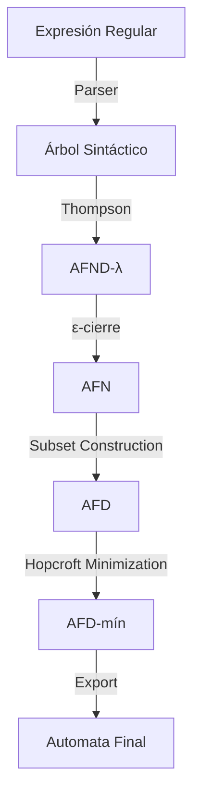

# Ejercicio 2 – Conversión de Expresiones Regulares a Autómatas

## Tabla de Casos (Lista 3 y Lista 4)

| N° ejercicio | Expresión Regular | Descripción del lenguaje | Cadenas válidas (3) | Cadenas inválidas (3) | Estados AFND‑λ | Estados AFD mínimo |
|--------------|-------------------|--------------------------|----------------------|-----------------------|----------------|-------------------|
| 241 | `a+(b*c)` | Palabras que empiezan con `a` seguida de cero o más `b` y un `c`. | `ac`, `abc`, `abbbc` | `a`, `ab`, `abb` | 5 | 3 |
| 242 | `(a|b)*abb` | Todas las palabras que terminan en `abb`. | `abb`, `aabb`, `bababb` | `ab`, `aab`, `bba` | 6 | 4 |
| 243 | `a*ba*` | Cadenas con al menos una `b` y cualquier número de `a` antes y después. | `ba`, `aba`, `aabaaa` | ``, `aa`, `bb` | 4 | 3 |
| 244 | `(ab)+c?` | Una o más repeticiones de `ab` opcionalmente seguidas de `c`. | `ab`, `ababc`, `ababc` | `a`, `b`, `abcabc` | 5 | 3 |
| 245 | `∅` | Lenguaje vacío. | *(ninguna)* | `a`, `` (palabra vacía), `ε` | 1 | 1 |
| 246 | `ε` | Sólo la palabra vacía. | `` (palabra vacía) | `a`, `b`, `ab` | 1 | 1 |
| 247 | `a(b|c)*d` | `a` seguido de cualquier secuencia de `b` o `c` y termina en `d`. | `ad`, `abd`, `acbd` | `a`, `d`, `abcd` | 6 | 4 |
| 248 | `(a|b)(c|d)` | Concatenación de una letra de `{a,b}` con una de `{c,d}`. | `ac`, `bd`, `ad` | `a`, `c`, `abcd` | 4 | 2 |
| 249 | `a?b+` | Opcional `a` seguido de una o más `b`. | `b`, `ab`, `bbb` | `a`, ``, `ba` | 4 | 2 |
| 250 | `((a|b)*)c` | Cualquier cadena de `a` y `b` terminada en `c`. | `c`, `ac`, `bababc` | ``, `a`, `b` | 5 | 3 |
| 251 | `(ab|cd)*ef` | Cadenas que consisten en repeticiones de `ab` o `cd` seguidas de `ef`. | `ef`, `abef`, `cdabef` | `ab`, `cd`, `efab` | 7 | 4 |
| 252 | `a(bc)*d?` | `a` seguido de cero o más repeticiones de `bc`, opcionalmente `d`. | `a`, `abc`, `abcbcd` | `b`, `c`, `ad` | 5 | 3 |
| 253 | `((a|b)(c|d))*` | Cualquier número de bloques de dos símbolos, cada uno escogido de `{a,b}` y `{c,d}`. | ``, `ac`, `bdac` | `a`, `c`, `ab` | 6 | 3 |
| 272a | `(a|b)+` | Una o más `a` o `b`. | `a`, `b`, `ababa` | ``, `c`, `aa c` | 3 | 2 |
| 272b | `a*` | Cualquier número de `a` (incluye vacío). | ``, `a`, `aaaa` | `b`, `ab`, `ba` | 2 | 1 |
| 272c | `(ab)*c?` | Repeticiones de `ab` opcionalmente seguidas de `c`. | ``, `ab`, `abc` | `a`, `b`, `ac` | 4 | 2 |
| 273 | `a(b|c)d` | `a` seguido de `b` o `c` y luego `d`. | `abd`, `acd`, `abd` | `ad`, `abcd`, `ab` | 4 | 2 |
| 278 | `((a|b)(c|d))?` | Opcionalmente un bloque de dos símbolos, cada uno de los conjuntos mostrados. | ``, `ac`, `bd` | `a`, `c`, `abcd` | 3 | 2 |

## Descripción de la canalización ER → AFND‑λ → AFN → AFD → AFD‑mín

1. **Parser de Expresión Regular (`parser_er.py`)**
   - Analiza la cadena de la ER usando una gramática LL(1).
   - Genera un árbol sintáctico abstracto (AST) donde los nodos representan operaciones `+`, `*`, concatenación y `λ`.
2. **Construcción del AFND‑λ (`er_a_automata.py`)**
   - Implementa el algoritmo de Thompson. Cada operador produce una sub‑estructura de estados y transiciones `λ`.
   - Conecta sub‑estructuras mediante concatenación, unión y cierre de Kleene.
3. **Eliminación de transiciones `λ` → AFN**
   - Calcula el cierre `ε`‑cierre de cada estado.
   - Reescribe las transiciones `λ` en transiciones directas sobre el alfabeto `{a,b}`.
4. **Determinización → AFD**
   - Algoritmo subset‑construction: cada estado del AFD es un conjunto de estados del AFN.
   - Se añaden transiciones para cada símbolo del alfabeto.
5. **Minimización del AFD**
   - Algoritmo de partición (Hopcroft) para agrupar estados equivalentes.
   - Se elimina cualquier estado inaccesible y se renumera los estados restantes.

## Diagrama Mermaid del pipeline de compilación de Thompson

## Notas técnicas de notación del curso

- `+` representa **unión** (OR).
- `*` representa **cierre de Kleene** (cero o más repeticiones).
- **Yuxtaposición** indica **concatenación** directa.
- `λ` representa la **palabra vacía** (ε).
- `∅` representa el **lenguaje vacío** (ninguna cadena).

## Referencias bibliográficas (APA 7)

- Hopcroft, J. E., Motwani, R., & Ullman, J. D. (2007). *Introduction to Automata Theory, Languages, and Computation* (3ª ed.). Pearson.
- Sipser, M. (2013). *Introduction to the Theory of Computation* (3ª ed.). Cengage Learning.

---
*Este documento fue generado automáticamente para la Práctica 4 de Teoría de la Computación (ESCOM‑IPN).*